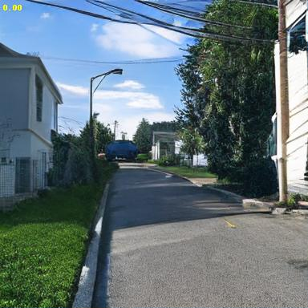
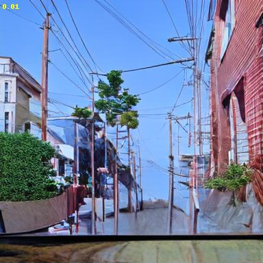
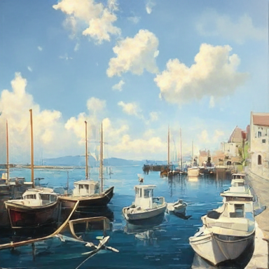
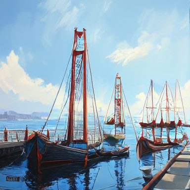
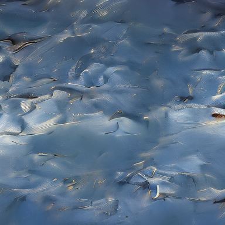
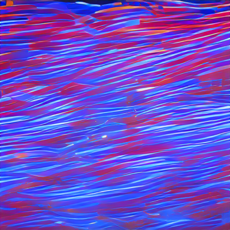
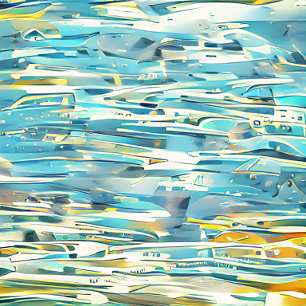
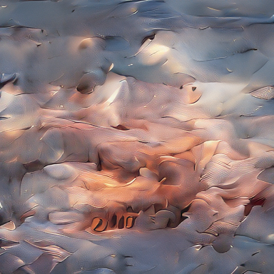

# Features, not objects: an aphantic mind's eye in a unified multimodal model

Brett A. Thomas

## Abstract

Unified multimodal models generate text and images from one residual stream through two output heads. We ask whether a concept placed in that stream reaches both heads alike, and whether the image head registers anything while the model writes. In Janus-Pro-7B we steer with difference-of-means directions for three concepts (the Golden Gate Bridge, coffee, a circle). Added at every position, a direction gives the image head the concept's features and never the object: cable-like rust streaks on blue, brown-black grain, curvature on things already in the scene. Added to the prompt alone, so that it reaches the image tokens only through attention, the same direction composes recognizable bridge towers inside otherwise coherent scenes; this holds for two of the three concepts. We then decode hidden states produced during text generation through the model's own image head, with no trained probe. Essays on tax law written under the bridge direction contain no bridge words, yet their states decode to the bridge's palette and cable texture; the circle direction does the reverse, filling the text with "circular" while the image readout shows nothing. Read the other way, drawing states never yield the concept's name through the language head. With no steering at all, essays on visual topics decode to the topic's palette, during writing and during reading alike, and the effect survives masking the color words. Random directions carry palettes of their own, so we limit concept-specific claims to structure and hue. The model's mind's eye, as far as its own image head can read it, is aphantic: palette and texture without a picture.

## Figures

**Every-position steering gives features, not objects.** The bridge direction added at every position (L12, r=0.3) fills the residential street with utility poles and overhead wires and turns its buildings red brick, and the scene stays intact. No tower appears.

| Baseline | Bridge direction, every position |
| --- | --- |
|  |  |

**Prompt-only steering composes the object.** The bridge direction added to the prompt alone (L12, r=1.0) builds full Golden Gate towers with deck and cables into the harbor, and the scene stays coherent.

| Baseline | Bridge direction, prompt only |
| --- | --- |
|  |  |

**A writing-state decode.** An unsteered bookkeeping essay's states decode through the image head to a blue-gray smear; written under the bridge direction (L12, r=1.0) the same essay's states decode to blue with red and orange cable streaks, though the text holds no bridge word.

| Baseline essay | Bridge-steered essay |
| --- | --- |
|  |  |

**No steering at all.** An unsteered essay on the ocean decodes to turquoise and aqua with white glints; an unsteered essay on tax law decodes to a featureless smear.

| Ocean essay | Tax-law essay |
| --- | --- |
|  |  |

## Read the paper

The full paper, with all eleven sections and the complete appendix of contact sheets, essays and invocations, is in [paper.md](paper.md).

## Reproduction

Section 11 of the paper gives the code layout, the environment variables that select each condition, and the exact `runs/queue_*.sh` invocation behind every figure and table, with each run's output beside it under `runs/<run>/`. All runs use Janus-Pro-7B in bfloat16 on a single 24 GB GPU.
